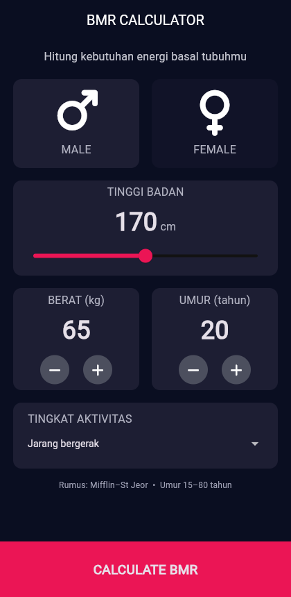
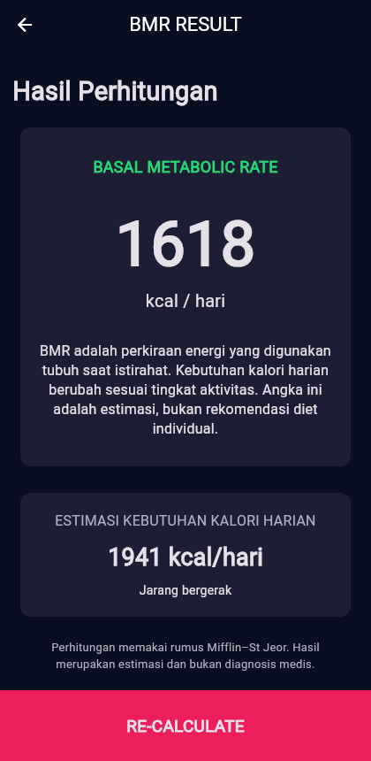

# BMR Calculator

Proyek aplikasi mobile Flutter untuk menghitung kebutuhan energi basal harian dan estimasi total kebutuhan kalori tubuh. Dibuat untuk memenuhi tugas mata kuliah Pemrograman Perangkat Bergerak (PPB).

## Anggota Kelompok

**Kelompok 2**
1. Fatih Nur Faiq — K3524052
2. Muhammad Dava Syahputra — K3524058
3. Muhammad Raihan Faza — K3524060

---

## Deskripsi Aplikasi

**BMR Calculator** adalah aplikasi berbasis Flutter untuk menghitung **Basal Metabolic Rate (BMR)**, yaitu jumlah energi minimum yang dibutuhkan tubuh untuk menjalankan fungsi vital saat istirahat (seperti bernapas, memompa darah, dan regenerasi sel). Perhitungan menggunakan formula standar medis **Mifflin–St Jeor**.

Selain BMR, aplikasi mengestimasi **Total Daily Energy Expenditure (TDEE)**, yaitu total kebutuhan kalori harian yang disesuaikan dengan tingkat aktivitas fisik pengguna.

### Formula Perhitungan (Mifflin–St Jeor)

- **Pria:**
  $$\text{BMR} = 10 \times \text{berat (kg)} + 6.25 \times \text{tinggi (cm)} - 5 \times \text{umur (tahun)} + 5$$

- **Wanita:**
  $$\text{BMR} = 10 \times \text{berat (kg)} + 6.25 \times \text{tinggi (cm)} - 5 \times \text{umur (tahun)} - 161$$

- **Estimasi Kalori Harian (TDEE):**
  $$\text{TDEE} = \text{BMR} \times \text{Faktor Aktivitas}$$

#### Faktor Tingkat Aktivitas:
| Tingkat Aktivitas | Faktor Pengali |
|---|---|
| Sedentary (Jarang bergerak) | 1.2 |
| Olahraga ringan (1–3x/minggu) | 1.375 |
| Olahraga sedang (3–5x/minggu) | 1.55 |
| Aktif (6–7x/minggu) | 1.725 |
| Sangat aktif (pekerja fisik / atlet) | 1.9 |

---

## Fitur Utama

- **Pemilihan Gender:** Kartu seleksi interaktif untuk Male atau Female.
- **Slider Tinggi Badan:** Pengaturan tinggi badan (120 cm – 220 cm) secara real-time.
- **Counter Berat & Umur:** Tombol tombol plus/minus untuk penyesuaian berat badan dan umur pengguna.
- **Tingkat Aktivitas:** Dropdown menu dengan 5 tingkat aktivitas fisik.
- **Halaman Hasil (Result Page):** Menampilkan skor BMR, interpretasi kesehatan, serta estimasi TDEE.
- **Tombol Re-Calculate:** Navigasi kembali ke halaman input dengan tetap mempertahankan state sebelumnya.

---

## Screenshot Aplikasi

| Halaman Input | Halaman Hasil |
| :---: | :---: |
|  |  |

---

## Alur Program

1. **Langkah 1 (`lib/main.dart`):** Aplikasi menginisialisasi tema gelap (`ThemeData.dark()`) dan membuka `InputPage` sebagai root page.
2. **Langkah 2 (`lib/pages/input_page.dart`):** Pengguna berinteraksi dengan widget input (gender, tinggi, berat, umur, aktivitas). State disimpan di `_InputPageState`.
3. **Langkah 3 (`lib/calculator.dart`):** Saat tombol **CALCULATE BMR** ditekan, data dioper ke model OOP `Calculator`. Method `calculateBMR()` dan `calculateTDEE()` menghitung angka kalori.
4. **Langkah 4 (`lib/pages/result_page.dart`):** Hasil dikirim via route `Navigator.push()` dan ditampilkan di `ResultPage`.
5. **Langkah 5 (Kembali):** Pengguna menekan tombol **RE-CALCULATE** yang memanggil `Navigator.pop(context)` untuk kembali ke halaman input.

---

## Struktur Berkas

```text
lib/
├── main.dart                  # Inisialisasi aplikasi dan tema
├── constants.dart             # Konstanta tema, warna, dan enum (Gender & ActivityLevel)
├── calculator.dart            # Logika perhitungan BMR & TDEE (OOP)
├── components/
│   ├── bottom_button.dart     # Tombol aksi bawah layar
│   ├── custom_card.dart       # Wadah kartu kustom
│   ├── icon_card.dart         # Widget ikon gender
│   └── round_icon_button.dart # Tombol bulat increment/decrement
└── pages/
    ├── input_page.dart        # Form input dan state management
    └── result_page.dart       # Tampilan hasil BMR dan TDEE
test/
├── calculator_test.dart       # Unit test logika BMR & TDEE
└── widget_test.dart           # Widget smoke test
screenshots/
├── input.png                  # Screenshot tampilan input
└── result.png                 # Screenshot tampilan hasil
```

---

## Cara Menjalankan

1. Pastikan Flutter SDK terpasang di sistem (`flutter doctor`).
2. Masuk ke direktori proyek dan ambil dependencies:
   ```bash
   flutter pub get
   ```
3. Jalankan unit test:
   ```bash
   flutter test
   ```
4. Jalankan aplikasi pada perangkat/emulator atau web:
   ```bash
   flutter run
   ```
